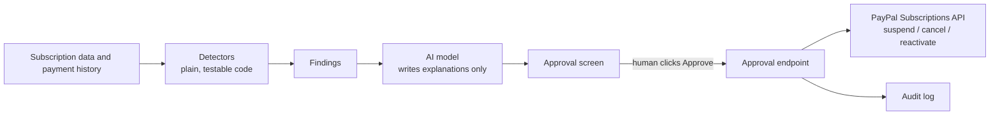

# Autopay Bouncer

**An AI agent that finds subscriptions you're wasting money on, explains why in plain English, and pauses them through PayPal only after you approve. Undo anytime.**

Built for the *Build What's Next with PayPal and AI* hackathon.

> **The AI never moves money.** It only writes explanations. The one code path that calls PayPal's suspend or cancel endpoints runs when a human clicks **Approve**.

<!-- Add a screenshot or GIF of the app here:  -->
<!-- Demo video: https://... -->

---

## The problem

Most people pay for something they've forgotten about: a price that quietly went up, a service they stopped using, two apps that do the same job. The money leaves in small amounts, so nobody notices. And "an AI that can spend your money" is not something people should have to trust blindly.

## What it does

Autopay Bouncer reviews recurring payments and flags four kinds of problems:

| Finding | What triggers it |
|---|---|
| **Price hike** | A subscription's latest charge is higher than its first |
| **Dormant** | No confirmed use for more than 60 days |
| **Duplicate** | Two active subscriptions in the same category (it keeps the one you used most recently) |
| **Failed payment** | The most recent charge did not go through |

For each finding, an AI model writes a short plain-language explanation and a suggested action. Nothing happens until you click **Approve**. On approval, the app calls PayPal to **suspend** (or **cancel**) the subscription. Suspended subscriptions can be **undone** with one click, and every action is written to an audit log.

## How it works



**Design principles**

1. **Detection is deterministic code**, not the model. It is easy to test and behaves predictably.
2. **The AI only explains.** It has no tools and no access to PayPal. Even a misbehaving model cannot change anything.
3. **Humans approve every action.** The approval endpoint is the only code that calls PayPal's suspend and cancel endpoints.
4. **Actions are reversible where PayPal allows it.** Suspended subscriptions can be reactivated. (Cancelled ones cannot, so the UI offers undo for suspends only.)
5. **If the AI is unavailable**, the app falls back to the plain detector text, so it never breaks.

## Tech stack

- **Backend:** Python, FastAPI, Uvicorn, httpx
- **PayPal (sandbox):** OAuth 2.0, Catalog Products, Billing Plans, Subscriptions API (create, show details, suspend, cancel, reactivate)
- **AI:** OpenAI Chat Completions API (default model `gpt-4o-mini`, configurable). The AI client uses a generic OpenAI-compatible interface, so other compatible providers work too.
- **Frontend:** a single static HTML and JavaScript page, no build step

## Getting started

### Prerequisites

- Python 3.9 or newer
- A free PayPal developer account: <https://developer.paypal.com>
- An OpenAI API key (or any OpenAI-compatible provider). Without one, the app still runs and shows the plain detector text.

### 1. Install

```bash
git clone https://github.com/dasshreyas8849/Autopay-Bouncer.git
cd Autopay-Bouncer

python -m venv .venv
# Windows (PowerShell):  .venv\Scripts\Activate.ps1
# Mac / Linux:           source .venv/bin/activate

pip install -r requirements.txt
```

### 2. Set up the PayPal sandbox

1. In the PayPal developer dashboard, go to **Testing Tools > Sandbox Accounts** and create two accounts:
   - a **Business** account (the merchant that owns the subscriptions)
   - a **Personal** account (the subscriber who approves them)
   
   Set the country of **both** to **United States**. Other countries can make the approval page fail with a generic error.
2. Under **Apps & Credentials** (Sandbox), create an app that uses the Business account, and copy its **Client ID** and **Secret**.

### 3. Configure environment variables

Create a `.env` file in the project root:

```env
PAYPAL_CLIENT_ID=your-sandbox-client-id
PAYPAL_SECRET=your-sandbox-secret
LLM_BASE_URL=https://api.openai.com/v1
LLM_API_KEY=your-openai-key
LLM_MODEL=gpt-4o-mini
```

`.env` is git-ignored. Never commit it.

### 4. Create the live sandbox subscriptions (optional but recommended)

```bash
python -m app.seed
```

The script creates two sandbox subscriptions and prints each one's ID and an approval link. For each link:

1. Open it and log in as the **Personal** sandbox account.
2. Click approve. (You will land on an `example.com` page, which is expected.)

Then open `app/data.py` and paste the printed IDs into the `paypal_id` field of **CineBox** (`id: 2`) and **TuneBox** (`id: 3`).

> Subscriptions without a `paypal_id` run in *guided mode*: the app records your decision but makes no PayPal call.

### 5. Run it

```bash
uvicorn app.main:app --reload
```

Open <http://localhost:8000>.

## Demo walkthrough

1. Check the PayPal sandbox **Subscriptions** page. The **Active** tab should show 2.
2. In the app, review the findings and the AI explanations.
3. Click **Suspend** on TuneBox. The action log shows `PayPal sandbox`.
4. Refresh the PayPal sandbox page. TuneBox now shows **Paused** (PayPal's dashboard calls the API's `SUSPENDED` status "Paused").
5. Click **Keep it** on another finding to see that nothing happens without approval.
6. Click **Undo** on TuneBox. Refresh PayPal, and it is Active again.

## Project structure

```
app/
  main.py        FastAPI app: state, approve / reject, undo endpoints
  detectors.py   Deterministic detection of price hikes, duplicates, etc.
  ai.py          Writes explanations (OpenAI-compatible API, with fallback)
  paypal.py      PayPal client: OAuth, suspend, cancel, activate, transactions
  data.py        Demo subscriptions, payment history, and usage check-ins
  seed.py        Creates the live sandbox plans and subscriptions
static/
  index.html     The single-page UI
reset.py         Reactivates the linked sandbox subscriptions between demo takes
```

## A note on the demo data

PayPal's Subscriptions API is built for **merchants**: it manages the subscriptions a business *sells*, not the ones a person *buys* from other companies. A consumer app therefore cannot pull someone's subscriptions to other services through this API.

For that reason the demo combines:

- **Six seeded subscriptions** with payment histories that contain realistic problems, and
- **Two live PayPal sandbox subscriptions** (CineBox and TuneBox) that the agent can genuinely suspend and reactivate.

Everything the app does to the live subscriptions is a real PayPal API call.

## Troubleshooting

| Problem | Cause and fix |
|---|---|
| `SUBSCRIPTION_STATUS_INVALID` when suspending | PayPal already has that subscription paused while the app thinks it is active. Reactivate it with `python reset.py` (or the Undo button), then try again. |
| PayPal approval page shows "We're sorry. Things don't appear to be working" | Sandbox accounts are probably not set to the United States. Recreate them with a US country, make a new app, update `.env`, and re-run the seed. |
| AI explanations look short and plain | The AI call failed and the app used its fallback. Check the terminal for an `AI call failed` message, and verify `LLM_API_KEY` and `LLM_MODEL`. |
| Page shows old UI after editing | Hard-refresh the browser with Ctrl+F5. |

## Limitations and what's next

- Subscription data is demo data plus two live sandbox subscriptions (see the note above).
- App state is held in memory, so restarting the server resets the findings.
- Planned: import a real PayPal activity CSV so anyone can audit their own recurring charges, a weekly "are you still using this?" check-in, webhook handling so the app updates when PayPal reports a change, and more detectors (such as free trials about to convert).

## License

MIT
